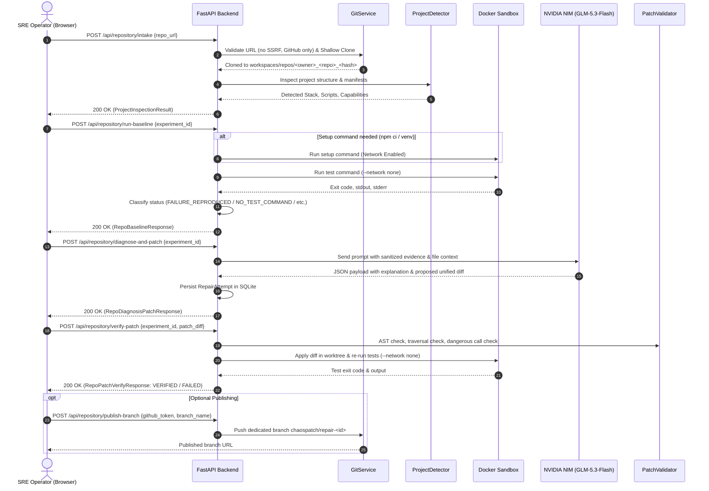

# CHAOSPATCH — End-to-End System Process & API Architecture Guide

> **"Inject failure. Let AI recover."**  
> CHAOSPATCH is an autonomous AI Software Reliability Engineering (SRE) workbench designed to reproduce real-world system failures, capture structured evidence, synthesize minimal unified code patches using state-of-the-art LLMs, enforce strict security and AST validation, and independently verify recovery inside disposable, air-gapped Docker sandboxes.

---

## Table of Contents

1. [Executive Overview & Operational Modes](#1-executive-overview--operational-modes)
2. [End-to-End System Architecture](#2-end-to-end-system-architecture)
3. [The 8-Stage Experiment State Machine](#3-the-8-stage-experiment-state-machine)
4. [Step-by-Step Technical Process Workflows](#4-step-by-step-technical-process-workflows)
   - [Workflow A: Universal Public GitHub Mode](#workflow-a-universal-public-github-mode)
   - [Workflow B: Controlled Microservice Chaos Mode](#workflow-b-controlled-microservice-chaos-mode)
   - [Workflow C: AI Inference & Patch Synthesis Flow](#workflow-c-ai-inference--patch-synthesis-flow)
   - [Workflow D: Patch Safety & Independent Verification Engine](#workflow-d-patch-safety--independent-verification-engine)
   - [Workflow E: Guarded Git Publishing & Artifact Export](#workflow-e-guarded-git-publishing--artifact-export)
5. [Complete REST API Reference](#5-complete-rest-api-reference)
   - [Health & System Readiness](#1-health--readiness)
   - [Dashboard Metrics](#2-dashboard)
   - [Chaos Scenarios Catalog](#3-scenarios-catalog)
   - [Controlled Experiments API](#4-experiments-api)
   - [Universal Public GitHub Repository API](#5-universal-public-github-repository-api)
   - [Settings & Model Connectivity Test](#6-settings--inference-connectivity)
6. [Security Architecture & Isolation Invariants](#6-security-architecture--isolation-invariants)
7. [Frontend Architecture & SRE Command Center](#7-frontend-architecture--sre-command-center)
8. [Repository Directory & Component Map](#8-repository-directory--component-map)

---

## 1. Executive Overview & Operational Modes

CHAOSPATCH operates across two primary workflows:

```
+-----------------------------------------------------------------------------------+
|                                 CHAOSPATCH MODES                                  |
+-----------------------------------------+-----------------------------------------+
| Mode 1: Controlled Microservice Chaos   | Mode 2: Universal Public GitHub Mode    |
| (Target: Sandboxed demo_app)            | (Target: Real-world Open-Source Repos)  |
+-----------------------------------------+-----------------------------------------+
| * Deterministic fault injectors         | * Safe shallow clone via GitService     |
| * 3 Canonical failure scenarios         | * Universal multi-stack adapter engine  |
| * Pytest suite verification             | * Air-gapped Docker execution sandbox   |
| * Step-by-step state machine with SSE   | * Operator-authorized patch publishing  |
+-----------------------------------------+-----------------------------------------+
```

### Core Invariants
1. **Never Trust LLM Self-Reporting**: A patch is never marked `VERIFIED` based on the LLM's explanation. Recovery is declared **only** if independent tests execute and pass cleanly (exit code `0`) inside the isolated sandbox.
2. **Strict Air-Gap Verification**: Docker test execution runs with `--network none`. Network access is permitted exclusively during initial dependency resolution.
3. **No Unbounded Root Execution**: Containers run with unprivileged user permissions, strict memory limits (`1g`), CPU quotas (`1.5 cores`), and process limits (`pids-limit 64`).
4. **Guarded Git Operations**: Default branches (`main`, `master`) are strictly protected. Fixes are published only to dedicated operator-named repair branches (`chaospatch/repair-<id>`). Force pushes are forbidden.
5. **No Secret Leaks**: Sanitizers automatically strip API keys, Bearer tokens, GitHub PATs, and credentials from all evidence items, logs, and frontend payloads.

---

## 2. End-to-End System Architecture

```mermaid
flowchart TD
    subgraph UI ["Frontend (React 18 + Vite + Tailwind)"]
        A1[Overview Dashboard]
        A2[Public GitHub Ingestion]
        A3[Scenario Launcher]
        A4[Terminal & Diff Viewer]
    end

    subgraph API ["FastAPI Backend (Port 8000)"]
        B1[Route Handlers /api]
        B2[RepositoryOrchestrator]
        B3[ExperimentOrchestrator]
        B4[SQLite Database / SQLAlchemy]
    end

    subgraph Inference ["AI Inference Provider (Strict Single-Model Lockdown)"]
        C1[NVIDIA NIM Provider\nz-ai/glm-5.3-flash]
        C2[Explicit Error Classification\nMODEL_FAILED / MODEL_TIMEOUT / MODEL_UNAVAILABLE]
    end

    subgraph Security ["Security & Isolation Layer"]
        D1[Git URL Validator]
        D2[ProjectDetector & Adapters]
        D3[AST PatchValidator]
        D4[FilesystemSecurityPolicy]
        D5[Docker Sandbox (--network none)]
    end

    UI -->|REST & SSE Stream| API
    B2 --> D1
    D1 --> D2
    D2 --> D5
    B2 --> C1
    C1 -.->|Timeout / Failure Fallback| C2
    C2 -.->|Offline Fallback| C3
    B2 --> D3
    D3 --> D4
    D4 --> D5
    B1 --> B4
```

---

## 3. The 8-Stage Experiment State Machine

Every controlled chaos experiment transitions through deterministic states managed by [ExperimentOrchestrator](file:///Users/ektasachdev/CHAOSPATCH_Hacktoberfest/backend/app/services/experiment_orchestrator.py):

```
[CREATED]
   |
   v
[INJECTING] --------> Injects failure fault (Config, Timeout, or Schema)
   |
   v
[BASELINING] -------> Executes baseline tests; records test failure
   |
   v
[OBSERVING] --------> Gathers logs, exceptions, and creates EVID-xxx artifacts
   |
   v
[DIAGNOSING] -------> Calls AI inference provider; synthesizes root cause & patch diff
   |
   v
[PATCH_REVIEW] -----> Halts for Operator Authorization (or auto-approves if configured)
   |
   +-----------------------+
   | (Approved)            | (Rejected)
   v                       v
[APPLYING]            [PATCH_REJECTED]
   |
   v
[VERIFYING] --------> Air-gapped test execution in Docker / disposable workspace
   |
   +-----------------------+
   | (Exit Code 0)         | (Exit Code != 0 / Error)
   v                       v
[VERIFIED]              [VERIFICATION_FAILED]
```

State transitions broadcast real-time events via Server-Sent Events (SSE) to connected clients at `GET /api/experiments/{id}/stream`.

---

## 4. Step-by-Step Technical Process Workflows

### Workflow A: Universal Public GitHub Mode



#### Detailed Breakdown of Public GitHub Mode:

1. **Intake & Validation**:
   - The user inputs any public repository (e.g. `https://github.com/pallets/flask`).
   - [GitService.validate_repository_url](file:///Users/ektasachdev/CHAOSPATCH_Hacktoberfest/backend/app/services/git_service.py) ensures:
     - URL scheme is strictly HTTPS.
     - Host is `github.com`.
     - No embedded user credentials (`user:pass@host`).
     - No loopback or internal addresses (SSRF prevention).
   - [GitService.clone_repository](file:///Users/ektasachdev/CHAOSPATCH_Hacktoberfest/backend/app/services/git_service.py) performs a shallow clone (`--depth 1`) into `workspaces/repos/<owner>_<repo>_<hash>`.

2. **Language & Script Inspection**:
   - [ProjectDetector](file:///Users/ektasachdev/CHAOSPATCH_Hacktoberfest/backend/app/adapters/detector.py) routes the project to a language adapter:
     - **NodeAdapter**: Inspects `package.json`. Looks for test candidate scripts (`test`, `test:unit`, `test:ci`). If missing, checks for validation scripts (`typecheck`, `lint`, `build`) without mislabeling them as test suites. If none exist, flags `can_run_tests=False`.
     - **PythonAdapter**: Discovers `pytest`, `unittest`, `setup.py`, `pyproject.toml`, or `requirements.txt`. Prepares container virtualenv command (`.chaospatch_env`).
     - **GoAdapter**: Discovers `go.mod` and configures `go test ./...`.
     - **RustAdapter**: Discovers `Cargo.toml` and configures `cargo test`.
     - **JavaAdapter**: Discovers `pom.xml` (`mvn test`) or `build.gradle` (`./gradlew test`).
     - **UnsupportedAdapter**: For unknown stacks, returns `UNSUPPORTED_TEST_ENVIRONMENT` rather than executing untrusted guesses.

3. **Isolated Baseline Execution**:
   - Executes inside disposable container via [DockerExecutionRunner](file:///Users/ektasachdev/CHAOSPATCH_Hacktoberfest/backend/app/sandbox/docker_runner.py).
   - Air-gapped network: `--network none`.
   - Returns honest statuses:
     - `BASELINE_PASSED`: All tests passed cleanly (no baseline failure).
     - `FAILURE_REPRODUCED`: Genuine test assertion failure reproduced.
     - `NO_TEST_COMMAND`: Repository has no test or validation scripts configured.
     - `MISSING_TEST_SCRIPT`: Package manifest defines a test command that does not exist.
     - `MISSING_TEST_RUNNER`: Executable (e.g. `pytest`) not found in container.
     - `SETUP_FAILED`: Dependency resolution error (`npm ci` or `pip install`).
     - `DOCKER_UNAVAILABLE`: Local Docker daemon unreachable.

---

### Workflow B: Controlled Microservice Chaos Mode

In Controlled Mode, CHAOSPATCH spins up an isolated instance of the bundled `demo_app` microservice.

#### Fault Injection Scenarios:
1. **Config Fault (`config_missing_key`)**:
   - Injected by [MissingConfigFault](file:///Users/ektasachdev/CHAOSPATCH_Hacktoberfest/backend/app/services/fault_injector.py).
   - Removes or comments out critical environment variables in `demo_app/config.py` (e.g., `PAYMENT_GATEWAY_URL`).
   - Symptom: `KeyError: 'PAYMENT_GATEWAY_URL'` during client initialization.
2. **Timeout Fault (`downstream_timeout`)**:
   - Injected by [DownstreamTimeoutFault](file:///Users/ektasachdev/CHAOSPATCH_Hacktoberfest/backend/app/services/fault_injector.py).
   - Injects simulated latency into external API calls or decreases client read timeout to 1ms.
   - Symptom: `httpx.ReadTimeout: The read operation timed out`.
3. **Schema Mismatch Fault (`schema_mismatch`)**:
   - Injected by [SchemaMismatchFault](file:///Users/ektasachdev/CHAOSPATCH_Hacktoberfest/backend/app/services/fault_injector.py).
   - Modifies downstream payload structure or changes dictionary keys in API parsers.
   - Symptom: `KeyError` or `ValidationError` when parsing upstream responses.

---

### Workflow C: AI Inference & Patch Synthesis Flow

1. **Evidence Aggregation**:
   - Gathers captured logs, stack traces, and test output excerpts.
   - Secrets and sensitive tokens are masked using `sanitize_secrets`.
2. **Provider Selection**:
   - [get_inference_provider()](file:///Users/ektasachdev/CHAOSPATCH_Hacktoberfest/backend/app/providers/__init__.py) loads the sole configured provider:
     - **NVIDIA NIM (`NvidiaNimProvider`)**: High-performance endpoint locked to `z-ai/glm-5.3-flash` at `https://integrate.api.nvidia.com/v1`.
     - **Strict Single-Model Policy**: No silent fallback, no secondary provider chaining, and no synthetic reference patches. On inference failure or timeout, the system reports explicit error codes (`MODEL_FAILED`, `MODEL_TIMEOUT`, `MODEL_UNAVAILABLE`) with empty diffs.
3. **Structured Prompt Construction**:
   - Formulates prompts optimized for instruction-tuned models without role confusion.
   - Requests a strict JSON schema containing:
     - `title`: Short title of the defect.
     - `root_cause`: Technical explanation of why the failure occurred.
     - `confidence`: Confidence score between `0.0` and `1.0`.
     - `proposed_patch_diff`: Syntactically correct **unified diff** (`--- a/...`, `+++ b/...`, `@@`).
     - `explanation`: Detailed commentary on how the patch remediates the fault.
     - `risk_summary`: Potential side-effects or architectural considerations.
4. **Resilience & Defensive Parsing**:
   - Fenced markdown blocks (```` ```json ````) are automatically stripped.
   - Diff validation verifies standard patch headers before proceeding.
   - Rate limits (HTTP 429) trigger exponential backoff retry.
   - Model timeouts trigger informative, non-fatal fallbacks.

---

### Workflow D: Patch Safety & Independent Verification Engine

Before applying any code patch to a workspace or container, it must pass a strict security pipeline:

```
Proposed Diff
     |
     v
[1. Patch Structure Validation] ---> Unified diff format check (---, +++, @@)
     |
     v
[2. AST Syntax Check] -------------> Parses modified code via ast.parse()
     |
     v
[3. Forbidden File Guard] ----------> Rejects edits to .env, .git, tests, Dockerfiles
     |
     v
[4. Traversal Guard] ---------------> Rejects paths escaping workspace root (../)
     |
     v
[5. Dangerous Calls Check] ---------> Blocks eval(), exec(), os.system(), __import__()
     |
     +---> If any check fails: Status = REJECTED (Zero workspace mutation)
     |
     v (All Passed)
[6. Safe Workspace Application] ----> Applied in isolated disposable worktree
     |
     v
[7. Docker Air-Gapped Test] --------> Executed with --network none
     |
     +---> Exit Code 0:  VERIFIED
     +---> Exit Code >0: FAILED
     +---> Docker Down:  INCONCLUSIVE
```

---

### Workflow E: Guarded Git Publishing & Artifact Export

1. **Publish to Dedicated Branch**:
   - Endpoint: `POST /api/repository/publish-branch`
   - Requires user's GitHub Personal Access Token (PAT).
   - Validates that the target branch is **not** a protected default branch (`main`, `master`, `trunk`, `release`).
   - Creates a dedicated branch named `chaospatch/repair-<experiment-id>`.
   - Pushes using git credentials scoped strictly to the child push command.
   - Never performs automatic pull-request merging or force pushes (`--force` is forbidden).
2. **Raw Patch Download**:
   - Endpoint: `GET /api/repository/export-patch/{experiment_id}`
   - Formats the verified unified diff into standard `.patch` format for manual `git apply` or code review.

---

## 5. Complete REST API Reference

Base URL: `http://localhost:8000/api`  
Interactive Swagger Docs: `http://localhost:8000/docs`

### 1. Health & Readiness

| Method | Endpoint | Description | Response Status |
| :--- | :--- | :--- | :--- |
| `GET` | `/api/health` | Overall system health, database status, and inference readiness | `200 OK` |
| `GET` | `/api/ready` | Kubernetes/service readiness probe verifying SQLite connection | `200 OK` |

#### `GET /api/health` Response Example:
```json
{
  "status": "healthy",
  "version": "0.2.0",
  "database": "connected",
  "inference": "nvidia"
}
```

---

### 2. Dashboard

| Method | Endpoint | Description | Response Status |
| :--- | :--- | :--- | :--- |
| `GET` | `/api/dashboard/summary` | Aggregate platform statistics, recovery rate, and recent runs | `200 OK` |

#### `GET /api/dashboard/summary` Response Example:
```json
{
  "total_experiments": 42,
  "successful_recoveries": 38,
  "failed_recoveries": 4,
  "verification_rate": 90.48,
  "avg_recovery_time_ms": 1420.5,
  "recent_experiments": [...],
  "scenario_distribution": {
    "config_missing_key": 14,
    "downstream_timeout": 16,
    "schema_mismatch": 12
  }
}
```

---

### 3. Scenarios Catalog

| Method | Endpoint | Description | Response Status |
| :--- | :--- | :--- | :--- |
| `GET` | `/api/scenarios` | Returns all available fault injection scenarios | `200 OK` |
| `GET` | `/api/scenarios/{scenario_id}` | Detailed metadata for a single chaos scenario | `200 OK` / `404` |

---

### 4. Experiments API

| Method | Endpoint | Description | Response Status |
| :--- | :--- | :--- | :--- |
| `POST` | `/api/experiments` | Create a new chaos experiment (`scenario_type`, `target_environment`) | `201 Created` |
| `GET` | `/api/experiments` | List experiments with pagination (`limit`, `offset`) | `200 OK` |
| `GET` | `/api/experiments/{id}` | Full details of a single experiment | `200 OK` / `404` |
| `POST` | `/api/experiments/{id}/start` | Start orchestrating the 8-stage state machine | `200 OK` |
| `POST` | `/api/experiments/{id}/cancel` | Abort a running experiment and clean up sandbox | `200 OK` |
| `GET` | `/api/experiments/{id}/events` | Chronological list of recorded events | `200 OK` |
| `GET` | `/api/experiments/{id}/stream` | **Server-Sent Events (SSE)** real-time stream | `text/event-stream` |
| `GET` | `/api/experiments/{id}/evidence` | List all evidence items (`EVID-xxx`) captured | `200 OK` |
| `GET` | `/api/experiments/{id}/repairs` | List all proposed AI repair attempts and diffs | `200 OK` |
| `POST` | `/api/experiments/{id}/repairs/{repair_id}/approve` | Operator approval to apply and verify patch | `200 OK` |
| `POST` | `/api/experiments/{id}/repairs/{repair_id}/reject` | Operator rejection of proposed patch | `200 OK` |
| `GET` | `/api/experiments/{id}/verification` | Verification check outcomes and execution traces | `200 OK` |
| `GET` | `/api/experiments/{id}/report` | Structured post-mortem report (JSON) | `200 OK` |
| `GET` | `/api/experiments/{id}/report/markdown` | Formatted markdown incident post-mortem | `text/markdown` |

---

### 5. Universal Public GitHub Repository API

| Method | Endpoint | Description | Response Status |
| :--- | :--- | :--- | :--- |
| `POST` | `/api/repository/intake` | Ingest repository, validate URL, clone, and inspect stack | `200 OK` / `400` |
| `POST` | `/api/repository/run-baseline` | Run baseline tests in isolated Docker container | `200 OK` / `400` / `404` |
| `POST` | `/api/repository/diagnose-and-patch` | Request AI root-cause diagnosis and candidate patch diff | `200 OK` / `404` |
| `POST` | `/api/repository/verify-patch` | Validate safety, apply diff, and re-test in Docker | `200 OK` / `404` |
| `POST` | `/api/repository/publish-branch` | Publish verified fix to dedicated `chaospatch/repair-<id>` branch | `200 OK` / `400` |
| `GET` | `/api/repository/export-patch/{id}` | Download verified patch as `.patch` file | `200 OK` / `404` |

#### Key Public GitHub Mode Schemas:

##### `POST /api/repository/intake`
- **Request Body**:
  ```json
  {
    "repo_url": "https://github.com/pallets/flask",
    "project_root": "/",
    "target_branch": "main"
  }
  ```
- **Response**: [ProjectInspectionResult](file:///Users/ektasachdev/CHAOSPATCH_Hacktoberfest/backend/app/schemas/repository.py)

##### `POST /api/repository/run-baseline`
- **Request Body**:
  ```json
  {
    "experiment_id": 232,
    "test_filter": "tests/test_basic.py"
  }
  ```
- **Response**: [RepoBaselineResponse](file:///Users/ektasachdev/CHAOSPATCH_Hacktoberfest/backend/app/schemas/repository.py)
  ```json
  {
    "experiment_id": 232,
    "baseline_status": "FAILURE_REPRODUCED",
    "exit_code": 1,
    "test_command": "pytest -v",
    "duration_ms": 1420,
    "output_excerpt": "FAILED tests/test_basic.py::test_login - AssertionError",
    "evidence_count": 1,
    "failing_tests": ["tests/test_basic.py::test_login"],
    "message": "Baseline test failure reproduced (exit code 1)."
  }
  ```

##### `POST /api/repository/verify-patch`
- **Request Body**:
  ```json
  {
    "experiment_id": 232,
    "patch_diff": "--- a/app.py\n+++ b/app.py\n@@ -1,3 +1,4 @@\n+if not x: return None"
  }
  ```
- **Response**: [RepoPatchVerifyResponse](file:///Users/ektasachdev/CHAOSPATCH_Hacktoberfest/backend/app/schemas/repository.py)
  ```json
  {
    "experiment_id": 232,
    "verification_status": "VERIFIED",
    "patch_valid": true,
    "target_failure_resolved": true,
    "regressions_detected": false,
    "exit_code": 0,
    "duration_ms": 1820,
    "test_output_excerpt": "3 passed in 0.42s",
    "summary": "Patch successfully verified in isolated Docker container."
  }
  ```

---

### 6. Settings & Inference Connectivity

| Method | Endpoint | Description | Response Status |
| :--- | :--- | :--- | :--- |
| `GET` | `/api/settings` | Non-sensitive system configuration, active models, and limits | `200 OK` |
| `POST` | `/api/settings/inference-test` | Round-trip connectivity and latency diagnostic test | `200 OK` |

---

## 6. Security Architecture & Isolation Invariants

```
+-----------------------------------------------------------------------------------+
|                           CHAOSPATCH SECURITY MATRIX                              |
+----------------------+------------------------------------------------------------+
| Vector               | Defensive Mitigation Mechanism                             |
+----------------------+------------------------------------------------------------+
| SSRF & Bad URLs      | Strict HTTPS validation; blocks private CIDRs, localhost,  |
|                      | and non-GitHub hostnames.                                  |
+----------------------+------------------------------------------------------------+
| Credential Leakage   | sanitize_secrets regex replaces tokens, keys, passwords   |
|                      | with [REDACTED_API_KEY] across stdout, stderr, and db.    |
+----------------------+------------------------------------------------------------+
| Path Traversal       | FilesystemSecurityPolicy resolves all paths against the    |
|                      | workspace root; rejects any relative escape (../).         |
+----------------------+------------------------------------------------------------+
| Forbidden Files      | AST and patch policies reject edits to .env, .git/,        |
|                      | test files, CI configs, and credentials.                   |
+----------------------+------------------------------------------------------------+
| Malicious Diff Code  | AST inspects diff bodies to block eval(), exec(),          |
|                      | os.system(), subprocess calls, and socket operations.      |
+----------------------+------------------------------------------------------------+
| Docker Sandboxing    | Tests execute with --network none, memory limits (1GB),    |
|                      | CPU limits (1.5), non-root unprivileged execution.        |
+----------------------+------------------------------------------------------------+
| Unintended Git Push  | Protects main/master; pushes exclusively to dedicated      |
|                      | chaospatch/repair-<id> branches; prohibits --force.       |
+----------------------+------------------------------------------------------------+
```

---

## 7. Frontend Architecture & SRE Command Center

The frontend is constructed with **React 18**, **TypeScript**, **Vite**, and custom **Tailwind CSS**, themed as an aerospace-grade SRE incident control room.

### Key Visual & Interactive Systems:
1. **Cinematic Aurora & Starfield Background**:
   - Implemented via Three.js ([@react-three/fiber](file:///Users/ektasachdev/CHAOSPATCH_Hacktoberfest/frontend/package.json) + [@react-three/drei](file:///Users/ektasachdev/CHAOSPATCH_Hacktoberfest/frontend/package.json)).
   - Subtle starfield with 3D depth combined with radial gradient aurora shifts.
   - Fixed globally behind all routes to maintain zero layout distortion.
2. **Kinetic Grid & Glassmorphism Surfaces**:
   - Bento-style information hierarchy with high-contrast status pills ([StatusIndicator](file:///Users/ektasachdev/CHAOSPATCH_Hacktoberfest/frontend/src/components/ui/StatusIndicator.tsx)).
   - Translucent frosted glass containers (`backdrop-blur-md`, `border-canvas-border`).
3. **Interactive Terminal Panels**:
   - Monospaced terminal emulator with ANSI color rendering, exit code tags, execution time counters, and one-click copy.
4. **Side-by-Side Diff Viewer**:
   - Visual unified diff colorizer showing line additions (`+`), deletions (`-`), and chunk headers (`@@`).
5. **Magnetic Interaction Utilities**:
   - Custom magnetic hover transitions on buttons and actionable cards.

---

## 8. Repository Directory & Component Map

```
CHAOSPATCH_Hacktoberfest/
├── backend/
│   ├── app/
│   │   ├── main.py                     # FastAPI application entrypoint & middleware
│   │   ├── core/
│   │   │   ├── config.py               # Pydantic BaseSettings & env configuration
│   │   │   └── logging.py              # Structured logging & secret redaction
│   │   ├── db/
│   │   │   └── database.py             # SQLAlchemy SQLite engine & session factory
│   │   ├── models/
│   │   │   └── experiments.py          # ORM models (Experiment, Incident, Evidence, Repair)
│   │   ├── schemas/
│   │   │   ├── experiments.py          # Controlled chaos request/response schemas
│   │   │   └── repository.py           # Universal Public GitHub mode schemas
│   │   ├── api/
│   │   │   └── routes/                 # REST router definitions
│   │   ├── adapters/                   # Universal language detection & script discovery
│   │   │   ├── base.py                 # Abstract ProjectAdapter interface
│   │   │   ├── python_adapter.py       # Python / pytest / venv adapter
│   │   │   ├── node_adapter.py         # Node.js / TypeScript / npm / vitest adapter
│   │   │   ├── compiled_adapters.py    # Go, Rust, and Java adapters
│   │   │   └── detector.py             # Scanner & monorepo project router
│   │   ├── providers/                  # AI Inference integrations
│   │   │   ├── base.py                 # Abstract InferenceProvider
│   │   │   └── nvidia_nim.py           # NVIDIA NIM (z-ai/glm-5.3-flash) provider
│   │   ├── sandbox/                    # Isolation boundaries
│   │   │   ├── docker_runner.py        # Disposable container runner (--network none)
│   │   │   ├── workspace.py            # Temporary worktree manager
│   │   │   └── filesystem_policy.py    # Path traversal & forbidden file blocker
│   │   └── services/                   # Business orchestration
│   │       ├── repository_orchestrator.py # Public GitHub flow coordinator
│   │       ├── experiment_orchestrator.py # 8-stage state machine engine
│   │       ├── fault_injector.py       # Deterministic chaos plugins
│   │       ├── patch_validator.py      # AST syntax & safety validator
│   │       ├── verification_engine.py  # Independent test verification runner
│   │       └── git_service.py          # Safe cloning & branch publisher
├── demo_app/                           # Target microservice for controlled chaos
├── frontend/                           # React 18 + TypeScript + Vite UI
│   ├── src/
│   │   ├── api/client.ts               # Typed REST API client
│   │   ├── components/                 # UI components (Navbar, AuroraBackground, Terminal)
│   │   ├── pages/                      # DashboardPage, RepoIntakePage, ExperimentDetailPage
│   │   └── types/index.ts              # TypeScript API contract definitions
├── docs/                               # Architecture, security & implementation specifications
└── tests/                              # Pytest test suite (78+ passing tests)
```

---

*Authored by: esachdev28 <esachdev5@gmail.com>*  
*Repository: https://github.com/esachdev28/Hacktober_2026*
